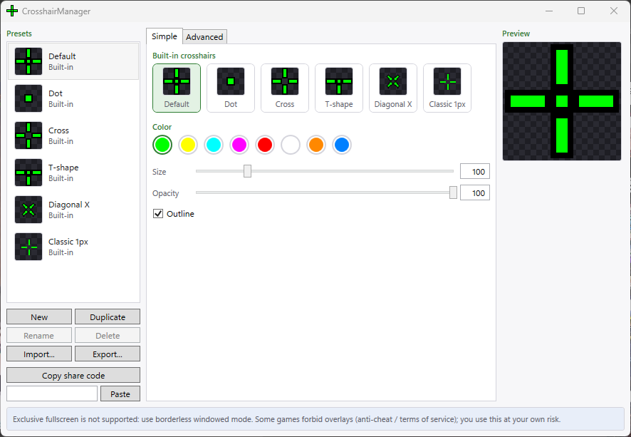
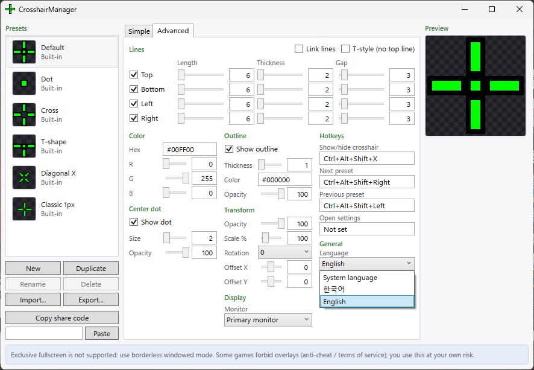

# CrosshairManager

[한국어](README.md)

A crosshair overlay for Windows. It draws your crosshair in a small transparent window on top of the screen, and mouse clicks pass straight through to whatever is underneath. It ships as one exe: no installer, no admin rights, no .NET install.

## Features

- Click-through, always-on-top crosshair overlay. The window is only as big as the crosshair and redraws only when a setting changes.
- Line length, thickness, gap, outline, center dot, color, opacity, rotation (45 degree steps) and scale
- Built-in and user presets, with import/export as JSON files or clipboard share codes
- Settings window with Simple and Advanced tabs, live preview and auto-save
- Multi-monitor selection with per-monitor DPI
- Tray icon menu, global hotkeys, single instance, optional start with Windows
- Korean and English UI (follows the system language by default; pick System language, 한국어 or English in settings)

## Screenshots

Simple tab:



Advanced tab with the language picker:



## Usage

1. Download `CrosshairManager-<version>-win-x64.exe` from [Releases](https://github.com/INOH-PARK/CrosshairManager/releases) and run it. The first run shows a notice dialog. Read it and accept.
2. Double-click the tray icon, or right-click it and choose "Open settings", to open settings. Pick a preset or change values and the overlay updates right away.
3. Run your game in **borderless** windowed mode (or windowed).
4. To quit, choose Exit from the tray menu.

### Default hotkeys

| Action | Hotkey |
| --- | --- |
| Show/hide overlay | `Ctrl+Alt+Shift+X` |
| Next preset | `Ctrl+Alt+Shift+Right` |
| Previous preset | `Ctrl+Alt+Shift+Left` |
| Open settings | not assigned |

You can change hotkeys in settings. Games that block system hotkeys may stop them from working. When that happens, use the tray icon menu. The tray always works.

### Data folder

Settings, presets and logs live in `%LocalAppData%\CrosshairManager`. Pass `--data-dir` to use a different folder.

```
CrosshairManager.exe --data-dir D:\CrosshairData
```

### What it leaves on your system

- Settings, presets and logs: only in the data folder above.
- Only when "Start with Windows" is on, it adds a `CrosshairManager` value under `HKCU\Software\Microsoft\Windows\CurrentVersion\Run`. Turning it off removes that value.
- There is no installer, and no other system settings are changed.


## Fullscreen games

Exclusive fullscreen isn't supported. In that mode the game owns the display and normal windows can't show on top (https://github.com/lacymorrow/crossover/issues/64). Set the game to **borderless** windowed mode instead. Microsoft describes the Windows 11 windowed game optimizations at https://support.microsoft.com/en-us/windows/hardware/display-graphics/optimizations-for-windowed-games-in-windows-11 .

## Anti-cheat and terms of service

CrosshairManager is a plain external window. It doesn't inject code into games, doesn't hook anything, doesn't read game memory and doesn't read the game's screen. It also doesn't detect which game is running or change behavior based on it.

Some games still ban external crosshair overlays through their terms or anti-cheat. Known cases as of November 2026 (https://www.chrossx.io/blog/are-crosshair-overlays-cheating):

- The Finals blocks third-party overlays.
- Battlefield 6 prohibits crosshair overlays that can be changed while playing.
- Riot (Vanguard) has no allow list.

Policies differ per game and can change. Check the game's terms yourself before you use this. Any account action or other consequence of using this app is your responsibility.

## Recordings and streams

The crosshair is a real window on your screen, so it shows up in anything you record or stream. There's no option to hide it from capture. Hide the overlay with the hotkey or tray when you record.

## SmartScreen warning

The exe isn't code-signed, so Windows SmartScreen may warn you on first run. Click "More info", then "Run anyway". You can also build it yourself.

## Supported systems

Tested on Windows 11. Windows 10 1903 or later is expected to work but hasn't been tested. x64 only.

## Build and test

You need .NET SDK 10.0.403. Scripts run on Windows PowerShell 5.1.

```
powershell -NoProfile -ExecutionPolicy Bypass -File scripts\verify.ps1
powershell -NoProfile -ExecutionPolicy Bypass -File scripts\perf-check.ps1
powershell -NoProfile -ExecutionPolicy Bypass -File scripts\publish.ps1
```

- `verify.ps1` builds, then runs the Core, Desktop and Ui tests. It fails if any test fails or is skipped. Close CrosshairManager before running it.
- `perf-check.ps1` measures idle CPU and memory. Use `-Exe` to point it at a specific exe.
- `publish.ps1` produces the single file `artifacts\publish\CrosshairManager.exe` and prints its size.
- `publish.ps1 -Version 1.2.3` stamps that version into the exe.

### CI and releases

- Every push to `main` and every pull request runs a GitHub Actions build plus the window-free tests (Core, the Desktop App and CLI tests, localization key parity). Screen tests need a real desktop, so they run only locally through `verify.ps1`.
- Pushing a tag like `v1.2.3` runs the same tests and creates a GitHub Release with the exe and its SHA-256 file attached.

```
git tag v1.2.3
git push origin v1.2.3
```

## Uninstall

1. In the settings window, turn off "Start with Windows" on the Advanced tab (only if you turned it on).
2. Choose Exit from the tray menu.
3. Delete `CrosshairManager.exe`.
4. To remove your settings too, delete `%LocalAppData%\CrosshairManager` (or the folder you passed with `--data-dir`).

If you deleted the exe without step 1, remove the `CrosshairManager` value from `HKCU\Software\Microsoft\Windows\CurrentVersion\Run`.

## Code signing policy

Free code signing provided by [SignPath.io](https://about.signpath.io/), certificate by [SignPath Foundation](https://signpath.org/).

The application is pending, and releases published so far are unsigned. Once approved, only files built by this repository's GitHub Actions are signed, and an approver reviews every release before it is signed.

- Committers and reviewers: [INOH-PARK](https://github.com/INOH-PARK)
- Approvers: [INOH-PARK](https://github.com/INOH-PARK)

Privacy policy: This program will not transfer any information to other networked systems unless specifically requested by the user or the person installing or operating it. It contains no networking code.


## License

MIT. See [LICENSE](LICENSE). Open source components are listed in [THIRD-PARTY-NOTICES.md](THIRD-PARTY-NOTICES.md).
