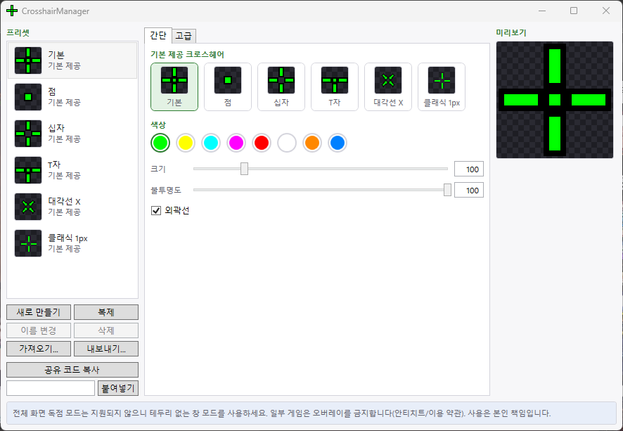
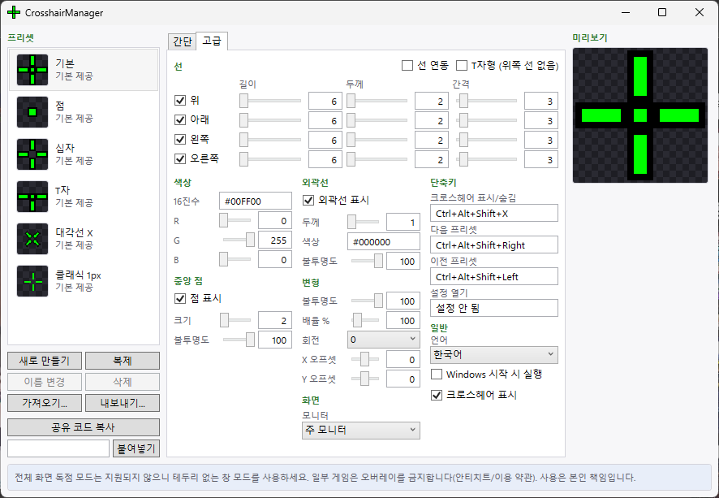
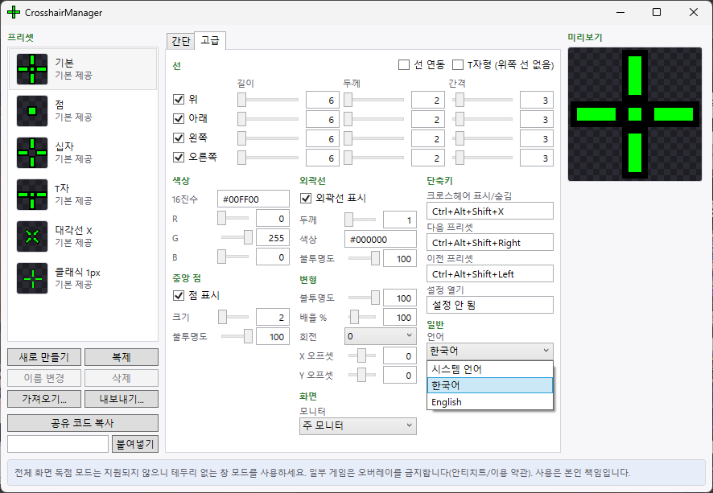

# CrosshairManager

[English](README.en.md)

Windows용 크로스헤어 오버레이입니다. 화면 위에 작은 투명 창을 띄워 크로스헤어를 그리고, 마우스 클릭은 그대로 아래 창으로 넘깁니다. 설치나 관리자 권한, .NET 설치 없이 exe 하나로 실행됩니다.

## 기능

- 클릭이 통과하는 항상 위 크로스헤어 오버레이. 창은 크로스헤어 크기만큼만 작고, 설정이 바뀔 때만 다시 그립니다.
- 선 길이, 두께, 간격, 외곽선, 가운데 점, 색, 불투명도, 회전(45도 단위), 배율 조절
- 내장 프리셋과 사용자 프리셋, 프리셋 JSON 파일과 클립보드 공유 코드 가져오기/내보내기
- 간단/고급 탭으로 나뉜 설정 창, 실시간 미리보기와 자동 저장
- 다중 모니터 선택(모니터별 DPI 대응)
- 트레이 아이콘 메뉴, 전역 단축키, 단일 인스턴스, Windows 시작 시 실행(선택)
- 한국어와 영어 UI(기본값은 시스템 언어, 설정에서 시스템 언어/한국어/English 중 선택)

## 스크린샷

간단 탭:



고급 탭:



언어 선택:



## 사용법

1. [Releases](https://github.com/INOH-PARK/CrosshairManager/releases)에서 `CrosshairManager-<버전>-win-x64.exe`를 내려받아 실행합니다. 처음 실행하면 주의 사항 대화상자가 뜹니다. 내용을 읽고 동의하세요.
2. 트레이 아이콘을 더블클릭하거나, 오른쪽 클릭한 뒤 "설정 열기"를 골라 설정 창을 엽니다. 프리셋을 고르거나 값을 바꾸면 오버레이에 바로 반영됩니다.
3. 게임은 **테두리 없는 창모드**(또는 창모드)로 실행합니다.
4. 끌 때는 트레이 메뉴에서 종료를 고릅니다.

### 기본 단축키

| 동작 | 단축키 |
| --- | --- |
| 오버레이 표시/숨기기 | `Ctrl+Alt+Shift+X` |
| 다음 프리셋 | `Ctrl+Alt+Shift+Right` |
| 이전 프리셋 | `Ctrl+Alt+Shift+Left` |
| 설정 창 열기 | 지정 안 됨 |

단축키는 설정에서 바꿀 수 있습니다. 시스템 단축키를 막는 게임에서는 단축키가 동작하지 않을 수 있습니다. 그럴 때는 트레이 아이콘 메뉴를 쓰세요. 트레이는 항상 동작합니다.

### 데이터 폴더

설정, 프리셋, 로그는 `%LocalAppData%\CrosshairManager`에 저장됩니다. 다른 폴더를 쓰려면 `--data-dir` 옵션을 줍니다.

```
CrosshairManager.exe --data-dir D:\CrosshairData
```

## 전체화면 게임

Exclusive 전체화면(전용 전체화면)은 지원하지 않습니다. 이 모드에서는 게임이 화면을 독점해서 일반 창이 위에 보이지 않습니다(https://github.com/lacymorrow/crossover/issues/64). 게임 설정에서 **테두리 없는 창모드**를 고르세요. Windows 11의 창 모드 게임 최적화 설명은 https://support.microsoft.com/en-us/windows/hardware/display-graphics/optimizations-for-windowed-games-in-windows-11 에 있습니다.

## 안티치트와 이용 약관 고지

CrosshairManager는 평범한 외부 창입니다. 게임에 코드를 주입하지 않고, 후킹하지 않으며, 게임 메모리를 읽지 않고, 게임 화면을 읽지 않습니다. 실행 중인 게임을 감지하거나 게임 상황에 따라 동작을 바꾸지도 않습니다.

그래도 일부 게임은 외부 크로스헤어 오버레이 자체를 약관이나 안티치트로 금지합니다. 2026년 11월 기준으로 알려진 사례(https://www.chrossx.io/blog/are-crosshair-overlays-cheating):

- The Finals는 외부 오버레이를 차단합니다.
- Battlefield 6는 실행 중 바꿀 수 있는 크로스헤어 오버레이를 금지합니다.
- Riot(Vanguard)에는 허용 목록이 없습니다.

게임마다 정책이 다르고 바뀔 수 있습니다. 사용 전에 해당 게임의 약관을 직접 확인하세요. 이 앱을 써서 생기는 계정 제재 등 모든 결과는 사용자 책임입니다.

## 녹화와 방송

크로스헤어는 실제 화면 위의 창이라 녹화나 방송 화면에도 그대로 찍힙니다. 녹화에 나오지 않게 하는 기능은 없습니다. 녹화할 때는 단축키나 트레이로 오버레이를 숨기세요.

## SmartScreen 경고

exe에 코드 서명이 없어서 처음 실행할 때 Windows SmartScreen이 경고할 수 있습니다. "추가 정보"를 누른 뒤 "실행"을 고르면 됩니다. 직접 빌드해서 써도 됩니다.

## 지원 환경

Windows 11에서 테스트했습니다. Windows 10 1903 이상에서도 동작할 것으로 예상합니다(직접 테스트하지는 않았습니다). x64 전용입니다.

## 빌드와 테스트

.NET SDK 10.0.403이 필요합니다. 스크립트는 Windows PowerShell 5.1에서 실행합니다.

```
powershell -NoProfile -ExecutionPolicy Bypass -File scripts\verify.ps1
powershell -NoProfile -ExecutionPolicy Bypass -File scripts\perf-check.ps1
powershell -NoProfile -ExecutionPolicy Bypass -File scripts\publish.ps1
```

- `verify.ps1`: 빌드한 뒤 Core, Desktop, Ui 테스트를 실행합니다. 실패하거나 건너뛴 테스트가 하나라도 있으면 실패합니다. 실행 전에 CrosshairManager를 꺼 두세요.
- `perf-check.ps1`: 유휴 CPU와 메모리 사용량을 잽니다. `-Exe`로 검사할 exe를 지정할 수 있습니다.
- `publish.ps1`: `artifacts\publish\CrosshairManager.exe` 단일 파일을 만들고 크기를 출력합니다.
- `publish.ps1 -Version 1.2.3`: exe 파일 정보에 버전을 넣습니다.

### CI와 릴리스

- `main`에 push하거나 PR을 열면 GitHub Actions가 빌드하고, 창을 띄우지 않는 테스트(Core, Desktop의 App·CLI, 언어 키 일치)를 실행합니다. 화면을 쓰는 테스트는 실제 데스크톱이 필요해서 로컬 `verify.ps1`로만 돌립니다.
- `v1.2.3` 형식의 태그를 push하면 같은 테스트를 거친 뒤 exe와 SHA-256 파일을 첨부한 GitHub Release가 자동으로 만들어집니다.

```
git tag v1.2.3
git push origin v1.2.3
```

## 라이선스

MIT. [LICENSE](LICENSE)를 보세요. 사용한 오픈소스 목록은 [THIRD-PARTY-NOTICES.md](THIRD-PARTY-NOTICES.md)에 있습니다.
